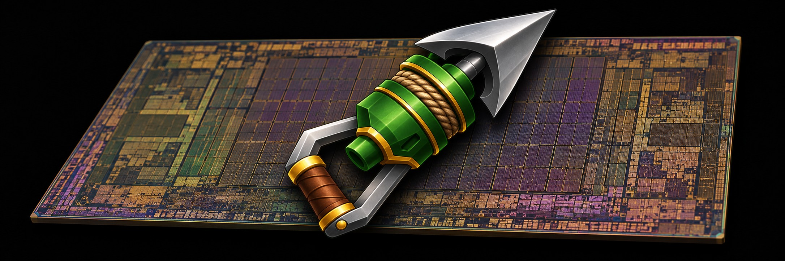

<p align="center">
  
  <br>
  <sub><sup>Die shot of AMD Oberon (PS5 SoC) by Fritzchens Fritz, via <a href="https://www.tomshardware.com/news/amd-oberon-playstation-5-soc-die-says-cheese-to-the-camera">Tom's Hardware</a></sup></sub>
</p>

<h1 align="center">Longshot Oberon</h1>

<p align="center">
  <b>The Legend of Zelda: Ocarina of Time (Switch 2) recompiled, running natively on the base PlayStation 5</b><br>
  Title <code>PPSA93339</code> · locked 30 fps STABLE up to 60 with built-in framegen · built from your own game file in one command, on Linux, WSL or Windows
</p>

<table align="center">
  <tr>
    <td><a href="#introduction">Introduction</a></td>
    <td><a href="#upstream-longshot-for-pc">Upstream: Longshot for PC</a></td>
    <td><a href="#status-and-performance">Status and performance</a></td>
  </tr>
  <tr>
    <td><a href="#install-and-play">Install and play</a></td>
    <td><a href="#addons-mods-and-button-prompts">Addons: mods and button prompts</a></td>
    <td><a href="#settings">Settings</a></td>
  </tr>
  <tr>
    <td><a href="#custom-implementations">Custom implementations</a></td>
    <td><a href="#my-own-manual-fixes-and-tests">My own manual fixes and tests</a></td>
    <td><a href="#build-from-source">Build from source</a></td>
  </tr>
  <tr>
    <td><a href="#credits">Credits</a></td>
    <td><a href="#license">License</a></td>
    <td><a href="!READFIRST_LIMITS_REACHED.md"><b>Limits reached</b></a></td>
  </tr>
</table>

---
## Introduction

Longshot Oberon is a port of [Longshot](#upstream-longshot-for-pc), the static recompilation of *The Legend of Zelda:
Ocarina of Time* for Nintendo Switch 2, to the **base PS5**. *Oberon* is the codename of the base PS5's system-on-chip,
and this port is tuned for it specifically: its 12 GB of memory for a title, its 6.5 cores' worth of CPU time, and its
RDNA2-class GPU driven through RADV, Mesa's Vulkan driver, built for the console.

The game's ARM64 code is translated to C ahead of time and compiled for the console's Zen 2 CPU. The game's NVN graphics
calls are recorded and replayed through Vulkan, and its shaders are translated to SPIR-V. Nothing is emulated at run time.

**The builder.** This repository holds no game files. Its release zip (`longshot-oberon-2.0.0.zip`) carries the source
and every tool the build needs, prebuilt for Linux and for Windows: the compiler, Python, the PS5 payload SDK, the graphics
driver, FFmpeg and the rest. Put your own game file in the unzipped `longshot_oberon` folder and run the builder for your
system, `bash build.sh` on Linux or WSL, or double-click `build.cmd` on Windows. Both make the same `eboot.bin` from the
same zip and game file. Out comes `dist/PPSA93339`, ready to copy to the console: the executable, the game's shader list, the PS5 button
prompts, the data mods, and the settings this port ships with. Nothing is downloaded and nothing is installed on your PC.
See [Install and play](#install-and-play).

**What it is built on.** The port started from the very first, primitive PS5 Hookshot release
([mihawk-99/PS5_Hookshot](https://github.com/mihawk-99/PS5_Hookshot) `ps5-v0.1.0-beta.2`). That release booted the game on a
PS5; on a base console it hung the GPU on the first 3D frame and ran out of memory at the first area change. From there
it was merged with Longshot v3.0.0-rc.4 and has followed Longshot's releases and nightlies since, porting their fixes
by hand, with the base-console work described below on top.

**What it is not.** It is not a fork of, and does not build on,
[heydemoura/PS5_Longshot](https://github.com/heydemoura/PS5_Longshot). That project was initially aimed at the PS5 Pro (inherited from Mihawk's) and is a
separate line of work. Two fixes are shared because both projects took them from Longshot (the voices' romfs paths,
Longshot #1346, and the stepped character-shadow storage, Longshot #1256).

---

## Upstream: Longshot for PC

**[Longshot](https://git.magicbean.dev/MagicBeanDev/Longshot)** by MagicBeanDev is the PC version and this port's
upstream: the renderer, the runtime, the lifter and most of the fixes come from it. If you want to play on a PC, use
Longshot. Longshot itself grew out of NotRexed's [Hookshot](https://git.notrexed.dev/Hookshot/Hookshot).

What was taken from Longshot, release by release and PR by PR, is in the [Credits](#credits).

---

## Status and performance

> [!NOTE]
> **Locked 30 fps, stable about 99% of the time in Kokiri Forest, Hyrule Field and the Castle Town market.**
> **Castle Town works.** Long sessions through a dozen areas hold their memory: no low-memory emergencies, no textures
> gone blurry in the market.

**2.0.0, the shipped profile** (base PS5, docked 1080p with FSR 3.1 upscaling from 1536×864, from the console's own logs):

| Run | Average fps | Frames over 40 ms (per 1,000) | Memory |
|---|---|---|---|
| Locked 30, 12 areas by save loads | 29.6 | 31.6 | Heap grows ~24 MB per new area (was ~100–130) |
| Unlocked, long session | 46.7 (median 46.8, worst 10%: 37.3) | 9.9 | 0 emergencies, lowest free 773 MB |

Against the 1.2.0-era builds on similar routes, unlocked: average fps ~45 → 46.7, frames over 40 ms ~16 → 9.9 per 1,000,
CPU about 15% lower; textures made small for want of memory in the market 1,800–10,600 a session → 2; lowest free memory
433–502 → 839 MB. Routes differ between runs, so compare loosely.

The older per-load table below is from the 1.x builds (handheld profile, frame rate left uncapped so the headroom shows;
with the 30 lock on, any window at 30 fps or above is a steady 30):

| Draws a frame | Average fps (lowest) | 5-second windows under 27 fps |
|---|---|---|
| 1,000–1,499 | 48.1 (35.5) | 0 |
| 1,500–1,999 | 42.8 (32.8) | 0 |
| 2,000–2,499 | 39.3 (30.9) | 0 |
| 2,500–2,999 | 33.9 (28.8) | 0 |
| 3,000+ | 30.6 (26.1) | 1 of 4 |

- 97.9% of all gameplay windows in that run were at 29.5 fps or above, with a per-draw diagnostic still switched on that
  has since been removed from the shipped settings.
- **Memory:** lowest free memory 646 MiB, median 1,370 MiB; no emergencies. Since 2.0 the texture reserve keeps 768 MB
  free for the game.
- **CPU:** the limit is the renderer's replay of the game's draws, on one thread. It is now **8.4 µs a draw**, down
  from 12–14 µs at the first boot. The GPU has headroom (about 10 ms a frame on average).
- **Picture:** since 2.0 the shipped profile is docked 1080p with the 3D drawn at 1536×864 and upscaled to a real 1080p
  by AMD FSR 3.1, sharpened before the HUD (`2b` in [Premade profiles](#premade-profiles)). The handheld profile (`1-SAFE`)
  stays the lightest. Native docked 1080p costs 130–450 MB more memory and doesn't raise the frame rate.
- **Unlocked:** unlocked framerate is an option and some closed-off areas or legacy dungeons can hit 50-60FPS without framegen,
  however locked 30 with some overhead in case of hitches is a better experience in my subjective opinion.
  Locked 30 also allows a smoother 2x for 60 via framegen.

**Known issues**
- Very rare crashes when entering busy areas - the game could reach an empty slot in its actor job lists. Release 2.0
  skips those entries and logs it (`oot: a null entry skipped in the actor jobs' loop (PG1 site N ...)`). If you see that line, the guard caught one.
- The first start translates every shader on the console (recorded 1 hour and 30 minutes on PS5 Slim, THIS IS A ONE TIME THING). See [First start](#first-start).
- Slight hitches can occur during sudden camera turns (180°) when facing a very busy area (a lot of draws). 2.0 draws
  a burst of new textures at low resolution first, which cut real hitches by about a third. Turning in busy areas is now almost 'perfect'.
---

> [!CAUTION]
> **Files in the title folder that can't be deleted.** Some files the title creates on the console, mostly in
> `cache/` (the shader cache, `longshot_swap.bin`), can refuse to be deleted or overwritten over FTP because of the
> permissions they were created with. Set the folder's permissions to `777` recursively, then delete:
>
> - **FileZilla (or a similar FTP client):** right-click the folder → *File permissions…* → numeric value `777`,
>   tick *Recurse into subdirectories* → *Apply to all files and directories* → OK. Then delete the files.
> - **A shell on the console:** `chmod -R 777 /data/homebrew/PPSA93339` and then `rm` what you need to remove.
>
> Only do this **inside `/data/homebrew/PPSA93339`**. Never change permissions on system folders or anything
> outside your homebrew folders. Close the title before you delete anything from it.

## Install and play

### What you need

- **The game:** *LoZ OOT* for NS2, version 1.1.1 (title `0400486024DEC000`,
  v131072), dumped by yourself as a `.nup` file. Before building, the builder checks:
  - the title and update inside the `.nup`;
  - every file the build reads, against the SHA-256 the `.nup` itself holds for it;
  - the game's program after extraction, against the known 1.1.1 hashes (`main` starts `2591fb99`).
 
  MD5:e5b85cea14686c5c6c75d05d57cb78a3
  SHA-256:a6c3a78cc8eae635b70c8cf8c4871685fa1fb204279169f30efbb62ab9e98be5

  Other versions are not tested (`--skip-hash-check` builds anyway, at your own risk). If the builder reports
  re-reads, or a file fails its hash only now and then, the PC's memory is returning wrong bytes: test it (MemTest86) and
  turn off memory overclocking (XMP/EXPO) before trusting a build (Including this because my own RAM was going bad while working on this)
- **The console:** a **base PS5** (disc or digital) on a jailbroken firmware with a homebrew environment (kstuff,
  elfldr, ShadowMountPlus) and an FTP server (ftpsrv). The Pro has more memory and native mesh shaders; this port does
  not target it. FALLBACK MESH SHADERS AS COMPUTE SHADERS ARE USED HERE, BUT THERE IS A MECHANISM THAT SHOULD ALLOW PRO TO USE NATIVE SHADERS.
- **The PC:** 64-bit Linux, Windows 10/11 with WSL2 (Ubuntu), or plain Windows 10/11 (`build.cmd`, no WSL). At least
  8 GB of memory for the build (the builder runs one compile per 6 GB), about 10 GB of free disk space, and 30–120
  minutes depending on your machine.

### Build the title

1. Download the release zip (`longshot-oberon-2.0.0.zip`) from the [Releases](../../releases) page. On plain Windows,
   skip to [Build on Windows](#build-on-windows-no-wsl).
2. Unzip it **inside Linux or WSL** (your Linux home folder, not a Windows drive: it builds several times faster there).
   On WSL, open *Ubuntu* and run:
   ```bash
   cd ~
   cp /mnt/c/Users/<you>/Downloads/longshot-oberon-2.0.0.zip .
   sudo apt install -y unzip    # if unzip is missing
   unzip longshot-oberon-2.0.0.zip
   cd longshot_oberon
   ```
3. Build, giving it your game file (a Windows path is under `/mnt/<drive>/`):
   ```bash
   bash build.sh /mnt/d/Games/oot.nup
   ```
   Or copy `oot.nup` into the `longshot_oberon` folder and run `bash build.sh` with no game file: the `.nup` beside
   `build.sh` is used.
   Options: `--jobs N` (files compiled at once; fewer if the build is killed for memory), `--out DIR` (also copy the
   finished folder there). An interrupted build continues where it stopped when you run it again. If one file's
   compile crashes (clang killed for memory), run the same command again: only what failed is compiled again.
   `build.sh` builds with the release's tested settings (`RX_FP_NATIVE=1` and the shipped profile `PS5_PGO`), as
   `build.cmd` does; set either one empty (`RX_FP_NATIVE= bash build.sh`) to build without it.

The result is `dist/PPSA93339`. Everything in it that was made from your game (`eboot.bin`, `image.bin`,
`longshot_shaders.bin`, `prompts/`) is yours alone: don't share it.

### Build on Windows (no WSL)

The same release zip builds on plain Windows: its `deps\windows\` folder carries LLVM 18.1.8, Python 3.12 and the build's
helpers for Windows, so nothing is installed. Unzip the release zip anywhere (a short path such as `C:\longshot` is best),
copy `oot.nup` into the `longshot_oberon` folder, beside `build.cmd`, and double-click `build.cmd`. About an hour the
first time. The title folder is `longshot_oberon\dist\PPSA93339`; the window and `build.log` end with where to put it and
`eboot.bin`'s sha256. Options (`--jobs 3`, `--out DIR`) go in a one-line `build_args.txt` beside `build.cmd`, or after
the game file on a command line (`build.cmd D:\Games\oot.nup --jobs 3`). An interrupted build continues where it stopped
when you run it again. From the same zip and game file, `build.cmd` and `build.sh` make the same `eboot.bin`.

### Put it on the console

1. Copy the whole `PPSA93339` folder to `/data/homebrew/PPSA93339`.
2. Copy your game file, named `oot.nup`, to one of these (the first one there is used):
   - `/data/homebrew/PPSA93339/oot.nup`: in the title folder itself, so everything is in one folder;
   - `/data/lichii/roms/oot/oot.nup`: shared with PS5_Lichii (make the folders);
   - `/data/prosperoeden/roms/oot/oot.nup`: Eden's rom folder;
3. Start **Longshot Oberon** from the home screen (ShadowMountPlus puts it there) or from your homebrew launcher.
ALSO TESTED - GAME LAUNCHES FROM EXPANSION SSD (EXT1) UNTESTED ON EXTERNAL SSD

### First start

The first start translates every shader of the game into `/data/homebrew/PPSA93339/cache/` (about 6.8 GB, 1.5 hours).
The title closes itself when it's done, because the translation's memory isn't given back. Start it again to
play. Later starts load from the cache. The cache is rebuilt only when a build changes the shader translator, and each
build prints its stamp (`2ad58d0865030a27`, unchanged since 1.2.0: a cache prepared by 1.2.0 stays valid).

Coming from the old `PPSA99024` Hookshot folder? Move its `cache/` into `PPSA93339/` and you keep the prepared shaders.
Then rename `hookshot_env.txt` to `longshot_env.txt`: this build reads only the new name.

---

## Addons: mods and button prompts

The title reads *romfs* mods from its `mods/` folder (`mods/<name>/romfs/...`, as emulators lay them out). A folder whose
name starts with `_` is skipped, so renaming a folder turns a mod on or off. The builder puts these in `mods/`:

| Mod | On by default | What it does | Measured |
|---|---|---|---|
| `PerfCombo` | yes | Sun-shadow reach 200 m with two cascades (`gsys/ModelSceneConfigParam`), and NPC shadows that fade out at 13–16 m (`System/GameGraphics/LocalDepthShadowParam`) | Lighter shadow work in busy scenes; MainField's sun shadows fade by 200 m anyway |
| `_PerfShadow500` | no | Sun-shadow distance of the first cascade 3000 → 500 (`gsys/ModelSceneConfigParam`) | 2,500–2,999 draws: 30.7 → 34.3 fps; lighter scenes unchanged |
| `_PerfShadow200` | no | The same at 200 | Further, more visible cut |
| `_PerfShadowLite` | no | 200, and two shadow cascades instead of three | Untested |
| `Saturation115` | yes | Turns on the game's own (shipped but disabled) colour-correction step, at saturation 1.15 with a neutral tint (`agl/ColorCorrectionParam`) | Visual only |
| `_Saturation130` | no | The same at 1.30 | Visual only |

Use one shadow mod (PerfCombo or one PerfShadow) and one saturation mod at a time: each group replaces the same file.
WARNING: Mods have largely been untested. This is very experimental.

**PS5 button prompts.** The builder runs Longshot's prompt generator on your game files. It redraws the game's button
icons (dialogue, hints, menus, the ocarina notes, the pause-menu controller) for other controllers from Kenney's CC0
Input Prompts, and writes them to `prompts/`. `longshot_options.ini` ships with `button_prompts=4`: PS5 icons. They
follow your button bindings.

---

## Settings

Two text files beside `eboot.bin` hold the settings. Edit them on the console over FTP.

- **`longshot_options.ini`**: the in-game menu's options (upscaler, FOV, controls, button prompts…). The shipped one is the
  tested setup: FSR 3.1 (`dlss=3`) with the Lanczos output filter, field of view 100, PS5 prompts, anisotropic filtering 4×,
  console-level shadows (`memory_budget=1`). The resolution and the handheld/docked profile are set by `longshot_env.txt`,
  which wins over the ini.
- **`longshot_env.txt`**: the engine switches, `NAME=value` per line, `#` for comments. The shipped one is the `2b`
  profile below with the quiet log (`HOS_KLOG=0`). The tested memory and performance values are built into the title
  since 2.0, so the file only holds what a player would change; a line in it still wins over a built-in value
  (`NAME=0` turns one off).

### Premade profiles

The easiest way to set up `longshot_env.txt` is to pick one of the ready-made profiles in
**[PREMADE-PROFILES](PREMADE-PROFILES/)**: download it, rename it to `longshot_env.txt` and copy it into
`/data/homebrew/PPSA93339/`, replacing the old one (the builder never overwrites an existing `longshot_env.txt`). All of them
share the same tested memory and performance settings; they differ only in resolution, the frame-rate lock and frame
generation.

| Profile | Handheld / docked | Game output → TV | 3D drawn at | FSR 3.1 | Frame rate |
|---|---|---|---|---|---|
| [`1-SAFE-handheld-30`](PREMADE-PROFILES/1-SAFE-handheld-30.txt) | Handheld | 1080p | 1536×864 | Anti-aliasing | Locked 30 |
| [`2-docked-1080p-30`](PREMADE-PROFILES/2-docked-1080p-30.txt) | Docked | 1080p → 1080p | 1920×1080 | Anti-aliasing | Locked 30 |
| [`3-docked-1080p-60-framegen`](PREMADE-PROFILES/3-docked-1080p-60-framegen.txt) | Docked | 1080p → 1080p | 1920×1080 | Anti-aliasing | Locked 30, 60 shown with frame generation |
| [`2b-docked-1080p-fsr-upscaled-30`](PREMADE-PROFILES/2b-docked-1080p-fsr-upscaled-30.txt) | Docked | 1080p → 1080p | 1536×864 | Upscaling to 1080p | Locked 30 |
| [`3b-docked-1080p-fsr-upscaled-60-framegen`](PREMADE-PROFILES/3b-docked-1080p-fsr-upscaled-60-framegen.txt) | Docked | 1080p → 1080p | 1536×864 | Upscaling to 1080p | Locked 30, 60 shown with frame generation |
| [`4-docked-1440p-fsr-upscaled-30`](PREMADE-PROFILES/4-docked-1440p-fsr-upscaled-30.txt) | Docked | 1440p → 1440p | 1920×1080 | Upscaling to 1440p | Locked 30 |
| [`5-docked-1440p-fsr-upscaled-60-framegen`](PREMADE-PROFILES/5-docked-1440p-fsr-upscaled-60-framegen.txt) | Docked | 1440p → 1440p | 1920×1080 | Upscaling to 1440p | Locked 30, 60 shown with frame generation |
| [`6-POTATO-test-unlocked-target60`](PREMADE-PROFILES/6-POTATO-test-unlocked-target60.txt) | Handheld | 1080p | 1152×648 | Upscaling to 1536×864 | Unlocked, aiming at a native 60 |
| [`RISKY-docked-1440p-native-30`](PREMADE-PROFILES/RISKY-docked-1440p-native-30.txt) | Docked | 1440p → 1440p | 2560×1440 | Anti-aliasing | Locked 30 |
| [`VERY-RISKY-docked-1440p-native-60-framegen`](PREMADE-PROFILES/VERY-RISKY-docked-1440p-native-60-framegen.txt) | Docked | 1440p → 1440p | 2560×1440 | Anti-aliasing | Locked 30, 60 shown with frame generation |

- **2b** is the shipped default and the setup 2.0 was tested with (logs over many long sessions). **SAFE** is the lightest:
  the game's handheld profile, its last step to the 1080p screen done by the Lanczos filter. The docked profiles draw more and look sharper on a TV, and use more memory (about 130-450 MB at 1080p).
- **2b / 3b** draw the 3D at SAFE's size (1536×864), and FSR 3.1 upscales it to a real 1080p instead of the Lanczos filter
  stretching it: sharper on a TV, with a native 1080p HUD, for about SAFE's memory plus the 1080p output buffers. See
  [Status and performance](#status-and-performance) for its numbers.
- **FSR 3.1 runs in every profile.** Where the 3D is drawn at the output's size it is the game's anti-aliasing; where it is
  drawn smaller, FSR 3.1 also upscales it, rebuilding detail from several frames: the FSR-upscaled 1440p profiles look
  between 1080p and native 1440p, with a native 1440p HUD.
- **RISKY / VERY-RISKY** draw the 3D at a true 2560×1440. In testing that used about 500 MB more memory and ran short in
  Castle Town: expect blurry textures and short hitches in busy places, more so in long sessions. Frame generation adds its
  own memory and GPU work on top. If that happens, use the FSR-upscaled 1440p profile.
- **POTATO** is an experiment: unlocked, with the resolution lowered so the GPU keeps up at 60. The frame rate here is limited
  by the CPU's work per draw, not by resolution, so 60 holds in light places (interiors, dungeons) while Hyrule Field,
  Castle Town and Kakariko run about 35-48 and judder between 30 and 60 on a 60 Hz TV.
- **On a 1080p TV**, the 1080p profiles are the better choice: the TV would scale a 1440p signal back down.
- **Frame generation** in these profiles is Longshot's built-in one (`RX_VK_FRAMEGEN=1`, `RX_VK_MIHAWKGEN=0`), from a locked
  30 to 60 shown: far less ghosting than MihawkGen. FSR's frame generation is not used: it breaks the HUD and ghosts.

**Lines you may change** (each profile has them at the top, with a comment):

| Line | Meaning |
|---|---|
| `HOS_KLOG=0` | Quiet log, worth 1–2%. Set it to 1 when you want a log to send with a problem (read via the kernel logger) |
| `HOS_PERF_30=1` | Locked, evenly paced 30: each frame shown for exactly two refreshes. `0`: unlocked |
| `RX_VK_UP_SHARPEN=15` | Sharpening of the 3D before the HUD, 0–100 |
| `HOS_RES_SCALE` | The 3D's size as a share of the output (`1`: the output's size; `0.75`: FSR 3.1 upscales from 75%) |
| `#HOS_SPRINT=0`, `#HOS_SPRINT_TOGGLE=0` | Remove the `#` to turn Sprint off, or to sprint only while L3 is held |
| `RX_VK_LIGHT_CAP=0` | Keep it at 0: any other value makes water reflections flash in long sessions (see [Known issues](#status-and-performance)) |

The rest of each profile is marked "tested values, don't change": the memory settings (the texture reserve, whose 2048 crashes
a base PS5, and the texture budget) and the performance settings this port's numbers were measured with.

---

## Custom implementations

Built for this port, for the base PS5. Each has a switch to turn it off. They are listed by area.

### Memory: 12 GB for the game, the driver and every texture

- **Memory guard** (`host/ps5/win32_ps5.c`). At start a 128 MB *parachute* of memory is taken and held. Under the
  texture reserve (768 MB free since 2.0), new textures are made smaller. Under 384 MB (since 2.0) the renderer enters *emergency* mode and drops textures unused for a
  few frames. If memory still runs out, the parachute is handed back at once. Under 192 MB for 2 seconds after that, or
  under 64 MB at any point, the title saves its caches and closes itself. This is the reason a memory problem ends the
  game and never takes the whole console down. (`HOS_PS5_MEM_GUARD`, `_PARACHUTE_MB`, `_MEM_LOW_MB`, `_MEM_FLOOR_MB`)
- **Swap file, the cold store** (`HOS_PS5_SWAP`). Game memory not touched for 60 seconds (90 before 2.0) is written to
  `cache/longshot_swap.bin` and its memory given back, while free memory is under 2.5 GB. To find cold memory it watches
  units by making them inaccessible and catching the first touch, which brings a unit back in about 0.5 ms. In handheld
  sessions it gave back 312–952 MB. In one market session it kept the console above the 512 MB emergency line it would
  otherwise have crossed. It releases its lock while it writes, so the game never waits on it (`HOS_PS5_SWAP_YIELD`).
- **Zero reclaim.** Every 20 seconds, game memory that held only zeros on two looks goes back to the pool. Memory
  handed to the GPU or to file reads is never touched. In early runs it gave back about 400 MB. (`HOS_PS5_ZERO_RECLAIM`)
- **Cold-memory meter.** It measured how much game memory stays untouched for 1, 5 and 10 minutes, which is what showed
  that a swap file would pay off. (`HOS_PS5_COLD`)
- **Texture reserve and budget.** 768 MB is always kept free for the game (1 GB before 2.0), the renderer's texture budget is 1,280 MB, and
  textures are capped at 1024 texels. The 2048 cap is held in code, because it once crashed the whole console.
  (`HOS_PS5_TEX_RESERVE_MB`, `RX_VK_VRAM_MB`, `RX_VK_TEX_MAX_DIM`)
- **Dedicated images only at about 1 MiB and up, and only while memory is short.** An "every image dedicated" experiment
  at 2 MiB and up once crashed the console into safe mode, so this rule is fixed.
- **Textures don't age in pause and menu frames.** Opening the inventory no longer evicts the world's textures, which
  removed the unpause hitch. (`RX_VK_EVICT_PAUSE_AGE`)
- **Packed shader code freed** once a program is loaded: about 100–120 MB of heap. (`RX_VK_DROP_PACKED`)
- **Depth images never filled from game memory**, which never holds their contents. One 2400×2400 shadow map upload went
  from 36 ms to nothing. (`RX_VK_DEPTH_UPLOAD`)
- **Close after shader preparation.** The translation's heap is not given back, so a start that translated shaders
  closes cleanly instead of playing on with gigabytes missing. (`RX_VK_PS5_PREPARE_STAY=1` keeps playing)
- **Zero-filled data (.bss) kept under 176 MB**, with the check at the link. Above about 188 MB the console refuses
  to start the title, and on one firmware the refusal crashed the console's system process. Large tables live on the
  heap instead. (`PS5_BSS_LIMIT_MB`)
- **Pipelines of areas left behind let go** (2.0, `RX_VK_PIPE_AREAS=3`, `0` turns it off). A new area is recognised by a
  burst of new textures after a quiet load; the pipelines of the area three areas back are destroyed once the GPU is done
  with them, and the shader modules made again for them are let go after a minute unused (`RX_VK_PR_MODULES=0` keeps
  them). Heap growth per new area ~100–130 MB → ~24 MB over a 12-area session. (Idea: me!)
- **Smaller GPU imports** (2.0, `RX_VK_IMPORT_CHUNK_MB=2`). The game's memory handed to the GPU is imported in 2 MB
  pieces instead of 16: memory pinned by imports 2.0–3.1 GB → 1.2 GB, which is what ended the blurry-market textures.
- **Less heap churn** (2.0, `RX_VK_HEAP_KEEP`, `RX_VK_HEAP_KEEP2`). zstd contexts and shader-module buffers kept per
  thread, video frames' 3 MB buffers recycled, written-page lists and the skinned-draw list reused: about 4 GB less
  allocated and freed a session, and less memory stranded inside the heap.
- **Texture eviction that follows free memory** (2.0, `RX_VK_EVICT_SLIDE`): how long unused textures are kept slides with
  free memory, capped at 64 textures / 64 MB a pass, which halved the long frames of a 180° turn.
- **Kept-ready pipelines let go under pressure** (2.0, `RX_VK_KEPT_READY_PRESSURE_MB`) and rebuilt on a worker later.
- **Built-in defaults** (2.0). The tested memory and performance values are set in the title itself, after
  `longshot_env.txt` is read and never over a line in it.

### GPU: RADV on Oberon

- **Mesh shaders as compute** (`RX_VK_FORCE_MESH_FALLBACK=1`, `RX_VK_FB_MULTI=1`). PS5_Mesa describes every PS5 GPU as
  GFX10.3, but the base console has GFX10.1-style primitive shaders and no mesh shaders, so the native task/mesh path
  hangs the GPU on the first 3D frame. Task and mesh programs run as compute shaders instead. A GPU-side gate draws their
  indirect draws record by record, which brings back the GPU-culled foliage.
- **The driver's NGG geometry path off** (`RADV_DEBUG=nongg`, set on every PS5; `HOS_PS5_NGG=1` keeps it). It is the
  same mismatch: with NGG on, long passes of lit draws stalled the GPU (the Kakariko gate, the night market's pine tree)
  until the console killed the title. Off, the hang was gone and the frame rate was unchanged.
- **GPU-hang watchdog.** After 3 seconds without a finished submission the title ends itself, with a GPU state dump in
  the log. (`RX_VK_GPU_HANG_SEC=3`). This also helps by not letting the console hard crash during any GPU hangs which
  could cause irreversible system corruption (reported by a tester on the early PS5_Hookshot - a crash caused a system restore)
- **Camera-turn textures, low resolution first** (2.0, `RX_VK_TEX_FIRST_SMALL_MB=24`). Past 24 MB of new textures in one
  frame, the rest are made at 256 texels and made again at their own size once the camera settles, largest on screen
  first. Real hitches dropped by about a third.
- **The exposure meter always read on time** (2.0, `RX_VK_METER_WAIT`). With late readbacks on, the meter's result could
  be a frame old and lit surfaces (water, glass under Navi's light) flashed in long sessions.
- **Reflection cubes redrawn in rounds** (2.0, `RX_VK_CUBEMAP_ROUNDS`): the two alternating cubes no longer go stale out
  of step, which made daytime water flash.

### CPU: the replay and the game's threads

- **Native thread-local storage** for the runtime and the renderer. The SDK's compiler wrapper emulates TLS, which made
  every access a library call. With native TLS each access is one load. It needed its own linker layout, because the
  console's loader rejects 64-byte TLS alignment. (`PS5_NATIVE_TLS`)
- **Renderer profile-guided optimisation for the console** (`PS5_VK_PGO`). A counting build writes its profile on the
  console (`host/pgo_rt.c`), and the release build is optimised with it: replay 11.2–11.6 → 10.7 µs a draw. The profile
  ships in `ps5/profiles/vk.profdata`.
- **ThinLTO for the renderer** (`PS5_VK_LTO=thin`): 10.7 → 10.1 µs a draw, and 26.7 → 28.7 fps at 2,500–2,999 draws.
- **The 680 hottest game functions at -O2** (Longshot's hot list), split into eight pieces so they compile in parallel.
- **Native floating point for the game's code** (2.0, `RX_FP_NATIVE=1` at build time, `nx2/fp_native.py`): the lifted
  code's floats are the host's, without the FPSR bookkeeping the game never reads. The game's CPU stopped setting the
  frame rate.
- **The game's hot code built with the console profile too** (2.0, `PS5_PGO`): one recording on the console serves the
  game's hot chunks and the renderer (`ps5/profiles/vk.profdata`).
- **Crash guards in the game's actor jobs** (2.0, `nx2/oot_patches.py`): empty entries in the actor job lists are skipped
  instead of followed, which ended a crash on entering busy areas without slowing the game's threads.
- **Locked 30, paced like a console** (`HOS_PERF_30`). The game steps exactly 1/30 s each frame, and the PS5's
  video output shows each frame for two vblanks through PS5_Mesa's flip-rate call. Movies keep their own rate.
- **Quiet log** (`HOS_KLOG=0`): only errors and crash lines go out.
- **Game-file dump for data research** (`HOS_FS_DUMP`). It made the shadow and saturation mods possible.

### Picture and sound

- **The sky fix.** New half-screen depth images start at "far" (1.0) instead of 0.0, so the Hyrule Field clouds no longer
  drop out for single frames and  they no longer flash.
- **Depth-comparison dummy.** Empty shadow-map slots read as lit, not black: correct shading where the game binds none.
- **5.1 mixed down to stereo** for the console's output.
- **Black props fixed.** The shader translator's guest page table now starts at the PS5 heap's address (16 GB), so the
  black boxes and props and the missing grass are gone.

### The builder

- `build.sh` and the bundled `deps/`. A self-contained clang/lld 18, Python 3.12 with the build's packages, and every
  PS5 library prebuilt, so a build needs nothing from the PC but bash and coreutils.
- It checks the game file (title, update and the hash of every file it reads) and lifts the game with Longshot's hot list. It makes the shader list and
  the PS5 button prompts from the game's own files, builds with the console profile and ThinLTO, and lays out the title
  with the shipped settings and mods.
- Checked against the development build: from the same `.nup`, the builder produces identical game code, an identical
  shader list and identical prompts.
- **`build.cmd`, the Windows builder** (2.0): the same steps in Python (`ps5/win_build.py`, `ps5/tools/link.py`) with the
  Windows tools in `deps/windows/`. Builds are reproducible: source paths are relative to the tree, `__FILE__` is mapped,
  so Windows and Linux builds from the same zip make a byte-identical `eboot.bin` (checked, every one of the 502 objects).
- **The game file found for you** (2.0): the `.nup` beside `build.sh` / `build.cmd` when none is named, and on the
  console `oot.nup` in the title folder itself, besides PS5_Lichii's folders and `HOS_PS5_NUP`.

---

## My own manual fixes and tests

Everything here was found and confirmed by me playing on a base PS5 with a kernel log (klog) running: more than 150 logged runs.
Each change was TESTED AND FIXED on its own, with a backup and an off switch, and the logs are the evidence.

| Problem | What was seen | Cause | Fix |
|---|---|---|---|
| GPU hang on the first 3D frame | Black screen, console GPU reset | Native mesh shaders on a GPU without them (see above) | Mesh programs as compute (`RX_VK_FORCE_MESH_FALLBACK`) |
| Out of memory at the first area change | Opening the door to Kokiri Forest: free memory hit 5 MB, GPU protection fault, the system UI restarted | 7–8 GB of game memory plus the driver's buffers plus textures over 12 GB | Memory guard, zero reclaim, texture reserve, compaction with 16 MB image blocks |
| Whole-console crash | The console restarted | `RX_VK_TEX_MAX_DIM=2048` | 1024-texel cap held in code |
| Console into safe mode | Needed a system reinstall | Every image of 2 MiB and up given dedicated memory | ~1 MiB rule, only while memory is short |
| Black props, black boxes, missing grass | All over the world | Every pointer the shaders loaded from a game pool read 0: the translator's page table covered 64 GB and 508 GB, the PS5 heap is at 16 GB | Page table window at the heap's address (found by translating the programs offline and reading their SPIR-V) |
| Voices missing | Narration and voice lines silent | Romfs paths with `//` | Longshot #1346 |
| Title refused to start, console system process crashed | "Not enough flexible memory to load executable" | .bss over the console's flexible memory | Tables to the heap, 176 MB check at the link |
| Clouds flashing in Hyrule Field | Clouds gone for single frames | Recreated half-size depth images started at 0.0, so the clouds failed their depth test | The sky fix (see above). It took 30+ test runs: every other rule tried either whitened the world or broke after the Temple of Time |
| White world frames | Single white frames, worst in the market | An experimental second read of the game's render conditions | That experiment switched off for good |
| Temple of Time light rays flashing | The rays flickered | An exposure-meter reading that came back zero reused a stale result | That hold switched off |
| GPU hang on lit draws | Freeze, then the title killed: the Kakariko gate route and the night market's pine tree | RADV's NGG geometry path on GC 10.1.3 | NGG off. Ruled out on the way, one run each: resolution, the breakable crates, cold store, VRAM compaction, texture eviction, the light-list loop, memory, occlusion queries, draw state, vertex data, any single program, shader loops, primitive binning |
| A wall lighting up as you approach | One building lit far too bright | The lit shaders' local-light list held up to ~24,000 lights a cell | First held by `RX_VK_LIGHT_CAP`, which made water flash in long sessions; no longer seen with the later fixes, the cap off (`0`) |
| Camera-turn hitches | 30–100 ms frames when turning | Hundreds of textures uploaded in one frame | Layer-batched uploads, ASTC read in place (2.6 GB not copied a session), the upload budget, the ASTC decoder with LDS scratch |
| Unpause hitch | A stall after the inventory | Textures evicted as "unused" during the pause | Pause frames don't age textures |
| Docked 1080p in the market | Two memory emergencies | 130–450 MB more for the renderer at 1080p | Ships in the handheld profile at 1080p output; 1440p tested too (another ~500 MB) |
| Slow frames from the present | ~3 ms waiting on the present's copy | A submission of its own | The present's copy merged into the frame's last submission |
| Crash entering Castle Town | A crash on the area's entry, in the game's actor jobs | An empty entry in an actor job list, followed | Empty entries skipped (2.0, the crash guards) |
| Water and glass flashing in long sessions | A light flash on reflective surfaces, also lit by Navi | The exposure meter's readback read a frame late | The meter always waits (2.0) |
| Daytime water flashing | Water flashed on some turns | The two alternating reflection cubes stale out of step | Cube faces redrawn in rounds (2.0) |
| Blurry market textures | Thousands of textures made small a session | 2–3 GB of game memory pinned by GPU imports | 2 MB import pieces (2.0): 2 a session |
| Heap growing with every area | ~100–130 MB more per new area | Pipelines and shader modules of every area visited kept | Areas left behind let go (2.0) |
| Neighbouring-area preload loop | A reload loop at the Gerudo Valley gate | The preloaded neighbour's choice flickering | Longshot #1814 / #1870 and ReLink's "hold only a flip back" rule |

Also measured and dropped, so nobody has to try them again: keeping textures longer (no gain), tiered texture shrinking
(memory emergencies), a CPU core mask (9% slower), a descriptor fast path (not worth it).

---

## Build from source

The [release zip](#build-the-title) is this repository plus `deps/`. To build from a clone instead:

```bash
git clone https://github.com/rimidalv333/longshot-oberon.git
cd longshot-oberon
# take deps/ from the release zip of the same version (it holds the Linux and the Windows tools):
unzip -q ../longshot-oberon-2.0.0.zip 'longshot_oberon/deps/*' -d /tmp/lo && mv /tmp/lo/longshot_oberon/deps .
bash build.sh /path/to/oot.nup    # or, on Windows, build.cmd
```

What `build.sh` runs, step by step, if you want to do it by hand (from the repository root, with
`deps/llvm/bin` and `deps/python/bin` first in `PATH`):

```bash
ulimit -s unlimited
export PS5_CLANG=$PWD/deps/llvm/bin/clang LLVM_CONFIG=$PWD/deps/llvm/bin/llvm-config \
       PS5_PAYLOAD_SDK=$PWD/deps/ps5-payload-sdk PS5_VULKAN=$PWD/deps/PS5_Vulkan \
       PS5_MIHAWKGEN=$PWD/deps/PS5_MihawkGen PS5_DEPS=$PWD/deps
# 1. the game's program out of the .nup, lifted to C with Longshot's hot list
python3 -I nx2/nup.py oot.nup --only exefs --extract work/game
OOT_WORK=$PWD/work/lift A64_HOT_FUNCS=$PWD/ps5/profiles/hot_funcs_longshot_v3.txt A64_HOT_CHUNK=1 \
  python3 -I -X utf8 nx2/lift.py --standalone --write --exefs work/game/exefs --work work/lift
python3 -I nx2/split_hot.py work/lift/sa/gen
# 2. the shader list and the button prompts, from the game's files
python3 -I nx2/nup.py oot.nup --only romfs --extract work/rx \
  --romfs-parts "Shader/,Layout2Shader/,Lib/,Movie/Ndve/,Effect/,Pack/ZsDic.pack.zs,System/Resource/,UI/Layout2Archive/,Font2/"
python3 -I nx2/shader_census.py work/rx/romfs --out longshot_shaders.bin
python3 -I nx2/prompt_assets.py --romfs work/rx/romfs --out prompts
# 3. compile and link: native floats for the game's code, the console profile and ThinLTO
RX_FP_NATIVE=1 PS5_PGO=$PWD/ps5/profiles/vk.profdata PS5_VK_PGO=$PWD/ps5/profiles/vk.profdata PS5_VK_LTO=thin \
  python3 -I ps5/build.py --jobs 4
```

Then copy `longshot_shaders.bin`, `prompts/` and the contents of `title/` into `dist/PPSA93339/`.

**Where things are**

| Path | What |
|---|---|
| `host/` | The runtime that stands in for the Switch's OS and SDK; `host/ps5/` is the PS5 layer (memory guard, swap file, romfs from the `.nup`) |
| `gpu/vk/` | The Vulkan renderer and Eden's shader recompiler |
| `nx2/`, `third_party/a64-kit/` | The lifter, the patches applied to the lifted game, the `.nup` reader, the shader list and prompt tools |
| `ps5/` | The PS5 build (`build.py`), link (`tools/link.sh`; `tools/link.py` on Windows), the Windows builder's steps (`win_build.py`), title metadata and icon (`sce_sys/`), the console profile and hot list (`profiles/`) |
| `build.sh`, `build.cmd` | The builders, Linux/WSL and Windows, from the same release folder |
| `title/` | The settings and mods that ship in the title folder |

**Rules for changes**
- Don't change the *stamped* files (`gpu/vk/vk_shader.cpp`, `vk_bank.cpp`, `vk_state.h`, `gpu/vk/eden/`, `sirit/`,
  `compat/`) unless you mean to. Any change to them makes every console translate all its shaders again. (THIS CAN TAKE 1.5H AGAIN)
  The build prints the stamp.
- Nothing that raises memory use goes in without a guard that backs off under the texture reserve.

---

## Credits

**This port** by [vladimir (rimidalv333)](https://github.com/rimidalv333) - developed with the help of Claude (Anthropic).

**Upstream and the projects ported from**

| Project | By | What was taken and how it was used |
|---|---|---|
| [Longshot](https://git.magicbean.dev/MagicBeanDev/Longshot) | MagicBeanDev and contributors | The base: renderer, runtime and lifter, merged at v3.0.0-rc.4 (`53f96d78`). Ported by hand since, through rc.6–rc.8, v3.0.0, v3.1, v3.2.0 and the nightlies up to nightly-805: #341, #391, #446, #472, #637, #903, #910, #923, #924, #936, #943, #952, #977, #1031, #1091, #1150, #1158, #1162, #1167, #1188, #1209, #1220, #1222, #1235, #1241–#1244, #1248, #1250, #1251, #1255, #1256, #1346, #1402, #1418, #1422, #1462, #1478, #1484, #1553, #1555, #1564, #1594, #1603, #1617, #1632, #1635, #1662, #1663, #1683, #1763, #1781, #1814, #1828, #1844, #1866, #1870, #2015, #2194, #2258, #2343, #2366; in 2.0: the exact ASTC decoder (#2314), the heap retry handing a full model heap's build to its parent (#2452), the static shadow map at reduced size (#1367, 75% on the PS5), command recordings handed over instead of copied (#1780), replay progress from the last timeline read (#1994), the background-bank throttle (#1642, included, off by default), and BC1 for finer opaque ASTC after #521's approach. Also its hot-function list, its button-prompt generator, and its Steam Deck findings (late readbacks, #238) |
| [Hookshot](https://git.notrexed.dev/Hookshot/Hookshot) | NotRexed and contributors | Longshot's own upstream; the a64-kit lifter and runtime (TOTKPort). The OptimizeChangeBank heap retry (`55d68e8cd6`, `65c1998222`) |
| [PS5_Hookshot](https://github.com/mihawk-99/PS5_Hookshot) | Mihawk-99 | The starting point: the first PS5 Hookshot release (`ps5-v0.1.0-beta.2`) and its PS5 build and link |
| [PS5_Vulkan](https://github.com/mihawk-99/PS5_Vulkan) | Mihawk-99, BlackBearReloaded | The Vulkan bring-up on the PS5: the RADV link recipe, the clang wrapper, the title converter, `libc.prx` |
| [PS5_Mesa](https://github.com/mihawk-99/PS5_Mesa) | Mihawk-99, on Mesa | RADV, Mesa's Vulkan driver, built for the console (`0f86253`) |
| [PS5_MihawkGen](https://github.com/mihawk-99/PS5_MihawkGen) | Mihawk-99 | Frame generation, compiled in with its trained network |
| [PS5 payload SDK](https://github.com/ps5-payload-dev/sdk) | John Törnblom; fork by Aleksei Kulaev | The platform layer the title is compiled and linked with |
| [ProjectReLink](https://github.com/pixl27/ProjectReLink) | pixl27 | Water-volume draws (`3af2a28`), pipelines by program (`e894874`), sync table (`b63c02a`), memory freed off the render thread (`4decf67`), retired pools (`d2c3497`), shared fallback buffers (`da8b11b`), native floating point in the lifter (`0a05c24`), upscaler sharpening before the HUD (0.7.9.3), the neighbouring-area rule (0.7.9.4), the parallel-snapshot idea (#102) |
| [HeyListen](https://github.com/Sacrappy/HeyListen) | Sacrappy | Texel copies without the virtual core (0.4.1), the exposure-meter fix (`33873659`, from Hookshot `53eb0441` by pixl27), kept descriptor pools (`6ed31109`) |
| [Rekarina](https://git.rekarina.dev/rekarina/rekarina) | Rekarina | Ideas only: reading the light-injection uniforms in place, early light results |
| [totk-pc-recomp](https://github.com/valentderah/totk-pc-recomp) | valentderah | Through Hookshot: the virtual cores' design and the host zstd decoder |

**Libraries and tools**

| What | License | Used for |
|---|---|---|
| Eden / suyu / yuzu shader recompiler, sirit | GPL-2.0+/GPL-3.0+ | Translating the game's shaders to SPIR-V |
| suyu's AArch64 → C translator | GPL | The lifter's instruction translation |
| AMD FidelityFX SDK (FSR 3.1), FSR API headers | MIT | The upscaler and anti-aliasing |
| Dear ImGui | MIT | The in-game menu, FPS counter, start screen |
| Libertinus fonts | OFL 1.1 | The overlays' fallback font |
| Kenney Input Prompts | CC0 | The PS5, Xbox, Steam Deck and keyboard button prompts |
| libopus 1.5.2 | BSD-3-Clause | The game's Opus audio |
| zstd 1.5.7, zbic (Atmosphere-NX's ZBIC zstd) | BSD / GPLv2 | Game data and module decompression |
| FFmpeg, dav1d | LGPL-2.1+ / BSD-2-Clause | The game's AV1 movies |
| Vulkan-Headers, SPIRV-Headers, VulkanMemoryAllocator | Apache-2.0 / MIT | Building the renderer |
| Intel XeSS headers, libretro CRT shaders | MIT / per file | Carried from Longshot (not used on PS5) |
| LLVM/Clang 18.1.8 (Linux and Windows releases) | Apache-2.0 WITH LLVM-exception | The bundled compiler and linker |
| llvm-mingw, zlib 1.3.1 | Apache-2.0 WITH LLVM-exception / zlib | Building `a64emit.dll`, `zbic.dll` and `ps5-native-tool.exe` for the Windows builder |
| CPython 3.12 for Linux and Windows (python-build-standalone), capstone, unicorn, numpy, lz4, zstandard, fontTools, Pillow, astc-encoder-py, texture2ddecoder | Various (in `deps/python`) | The build's tools |

Every vendored component's provenance and license text is beside it: `third_party/*/PROVENANCE.md`,
`gpu/PROVENANCE.md`, `host/PROVENANCE.md`, and `deps/SOURCES.txt` in the release.

**Banner:** Oberon die photography by Fritzchens Fritz
([Tom's Hardware](https://www.tomshardware.com/news/amd-oberon-playstation-5-soc-die-says-cheese-to-the-camera)), with
Longshot's icon.

This project contains no game code or data and is not affiliated with Nintendo or Sony. Build only from a game you own.

---

## License

Longshot Oberon is free software, licensed under the **GNU General Public License v3.0**, as Longshot and Hookshot are.
See [`LICENSE`](LICENSE). You may copy, change and share it under the GPL's terms. Anything you distribute that is built
from it must carry its source under the same license. Third-party components keep their own licenses, listed in
[Credits](#credits) and beside each component.
